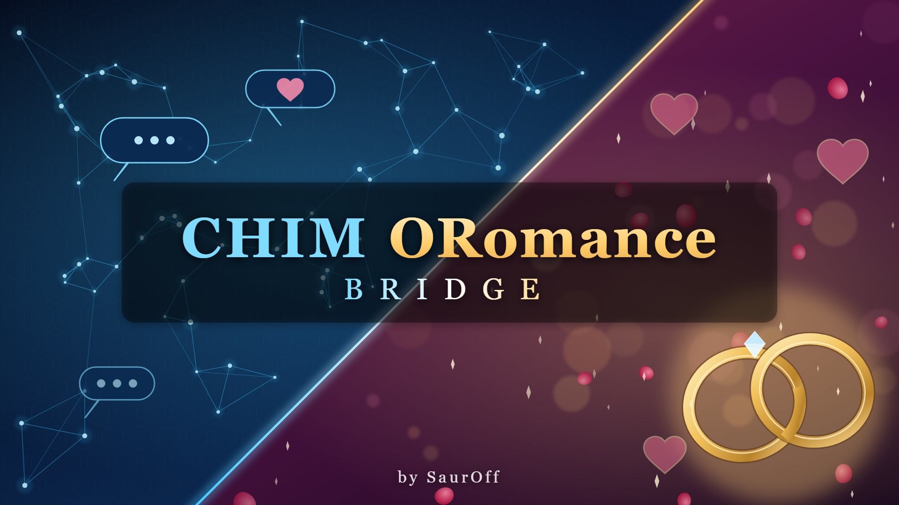

# CHIM ORomance Bridge

A Skyrim SE/AE mod by **SaurOff** that connects [CHIM](https://www.nexusmods.com/skyrimspecialedition/mods/126330)
(AI-driven NPCs) with [ORomance Plus](https://www.nexusmods.com/skyrimspecialedition/mods/81635).
Love grows from what you say and do in conversation, CHIM agents become your partner and
marry you when they want to (several spouses), and spouses live as spouses: they talk to
each other, share the household, ask for the marital duty and - if you like - want
children, knowing where they are in their cycle with Fertility Mode.

It is the companion of my other mod **CHIM OStim Bridge**
([Nexus](https://www.nexusmods.com/skyrimspecialedition/mods/194761) ·
[GitHub](https://github.com/SimpleL97/CHIM-OStim-Bridge)), built the same way. It is an
optional but recommended dependency: with it, spouses start the intimate scenes they ask for.

> **Adult content.** This mod deals with sexual content in a video game and is meant
> for adults only.

> **Nexus page: [CHIM ORomance Bridge](https://www.nexusmods.com/skyrimspecialedition/mods/198436)** - download the packaged release there. Marriage and everything around it was planned for CHIM OStim Bridge 1.2 and
> lives here instead; CHIM OStim Bridge has none of it.

This repository is the complete source of the mod. Players should download the packaged
release (FOMOD archive) from the [Nexus page](https://www.nexusmods.com/skyrimspecialedition/mods/198436) instead of building it.

- **[BUILDING.md](BUILDING.md)** - how to build the release from these sources, step by
  step, and where every file in the release comes from
- **[DEPENDENCIES.md](DEPENDENCIES.md)** - every requirement and what it is used for
- [docs/README.txt](docs/README.txt) - the player readme shipped in the archive
- [docs/CHANGELOG.txt](docs/CHANGELOG.txt)

## What it does

**AI actions** added to CHIM's action list. All are done through ORomance Plus, and each can
be switched off there:

| Action | What the agent does |
|---|---|
| `Feel_Affection` | something you said or did truly touched them (a compliment, a gift, a kiss, a declaration of love): raises ORomance like, and love for kisses and declarations. Limited per day (MCM). With "forgive", they make up after a quarrel or a breakup: dislike and hate go down, and a hostile NPC talks to you again. |
| `Feel_Hurt` | you insulted or hurt them (an insult, cruelty, cheating): raises ORomance dislike |
| `Become_Partner` | they agree to be your girlfriend or boyfriend |
| `Marry_Player` | they say yes to your proposal (you wear an Amulet of Mara). Every spouse is engaged, then married at the Temple of Mara; later ones in ORomance Plus's own ceremony. A wedding that got stuck is repaired. |
| `Take_Household_Duty` | a spouse takes on a duty (cooking, cleaning, guarding the house...). All spouses remember who does what. |
| `Give_Homemade_Meal` | a spouse gives you a homemade meal (ORomance, once a day) |
| `Move_In` | a spouse moves into the home you agree on (ORomance's own house-select; MCM) |

Every result is reported back to the AI, so a refusal ("not enough love yet", "you are
already engaged") is answered in character.

**Love**
- **ORomance's odds** for becoming a couple and for marriage (love, level, Speech, fame)
  can be used or left out (MCM). Left out, the agent's yes and the amulet are enough.
- **The proposal line:** ORomance Plus hides the vanilla marriage dialogue. The mod puts
  "(Amulet of Mara) Will you marry me?" back into the normal dialogue menu.
- **Love from sex:** every OStim scene with you raises ORomance like and love, up to
  ORomance's own ceilings (10, partner 20, spouse 30). Aggressive scenes do not count.
- **Feelings in words:** each agent's ORomance like, love and dislike for you go into
  their prompt, so what they say fits the game.

**Married life** (any number of spouses)
- Spouses know their marriage and each other.
- When together, now and then they talk to each other: about you, the household, the
  children they want.
- **The marital duty:** after a wait set per spouse (MCM), they ask for it more and more
  openly, each in their own character. With CHIM OStim Bridge they start the scene.
- **Dates and anniversaries:** an evening at an inn is a date. A spouse or partner asks
  you out when the last date was long ago, and spouses know the wedding's anniversaries.
- A spouse who moved in knows that home is theirs.

**Children** (MCM: names)
- The people listed want a child with you.
- With Fertility Mode 3 and its Fixes and Updates they know their cycle or pregnancy:
  before ovulation, ovulating, on their period, how far along, recovering from a birth.
- Every OStim Standalone scene reaches Fertility Mode, NPC couples' scenes too.
- Births whose father is you are kept as your children, with the mother, the age and the
  name. Everyone close to you knows them.

**News:** an engagement, a wedding, a pregnancy or a birth reaches the AI agents around.
The ones who love you know whom you lately got engaged to or married, and your spouses
know about a new spouse.

**Also:** notifications and a log file in the game and on the CHIM server, and an MCM
through MCM Helper in 12 languages with English fallback.

## My CHIM mods

| Mod | What it adds | Get it |
|---|---|---|
| **CHIM OStim Bridge** | AI agents start, change and end OStim scenes; reactions, talk and cries of passion during scenes; needs | [Nexus](https://www.nexusmods.com/skyrimspecialedition/mods/194761) · [GitHub](https://github.com/SimpleL97/CHIM-OStim-Bridge) |
| **CHIM ORomance Bridge** (this one) | love, partners and marriage (several spouses) through ORomance Plus, married life, children with Fertility Mode | [Nexus](https://www.nexusmods.com/skyrimspecialedition/mods/198436) · [GitHub](https://github.com/SimpleL97/CHIM-ORomance-Bridge) |
| **CHIM Vampire Bridge** | vampires: blood thirst, the bite, Vampire Lords, thralls who obey | [GitHub](https://github.com/SimpleL97/CHIM-Vampire-Bridge) (Nexus later) |
| **CHIM Travel Fix** | Travel_To goes to the place the agent named, in any game language, not a random one; a spouse sent "home" finds the house | [GitHub](https://github.com/SimpleL97/CHIM-Travel-Fix) (Nexus later) |

Each works on its own, and none needs another. Installed together, they see each other:
- spouses who ask for the marital duty start the scene through CHIM OStim Bridge;
- a spouse listed there for hunger for sex gets that instead of the marital duty here;
- what happens in one mod reaches every AI agent nearby.

## Supported mods

| Mod | | |
|---|---|---|
| [CHIM](https://www.nexusmods.com/skyrimspecialedition/mods/126330) | required | plugin and server; tested with 3.4.2 |
| [ORomance Plus](https://www.nexusmods.com/skyrimspecialedition/mods/81635) | required | with its own requirements, among them [ORomance](https://www.nexusmods.com/skyrimspecialedition/mods/48564) |
| [OStim Standalone](https://www.nexusmods.com/skyrimspecialedition/mods/98163) | required | tested with 7.5.1 |
| [PapyrusUtil SE/AE](https://www.nexusmods.com/skyrimspecialedition/mods/13048), [SkyUI](https://www.nexusmods.com/skyrimspecialedition/mods/12604), [MCM Helper](https://www.nexusmods.com/skyrimspecialedition/mods/53000), [Address Library](https://www.nexusmods.com/skyrimspecialedition/mods/32444) | required | |
| [Fertility Mode 3](https://www.nexusmods.com/skyrimspecialedition/mods/13068) + [Fixes and Updates](https://www.nexusmods.com/skyrimspecialedition/mods/46820) | optional | cycle, pregnancy, births, children |

## How it works

```
          Skyrim (game)                                    CHIM server (WSL, HerikaServer)
 +-------------------------------+                 +------------------------------------------+
 | CHIMORomanceBridge.esp (ESL)  |                 | ext/cor_oromance_bridge/                  |
 |  COR_Bridge  <----------------+-- ExtCmdCOR_*   |  functions.php   actions for the LLM,     |
 |   actions via COR_Romance     |   (via COR)     |                  installed into           |
 |   -> ORomance Plus, reports --+---------------->|                  core_action_custom      |
 |  COR_Events                   |   funcret       |  prompts.php     cues for the events      |
 |   ORomance + Fertility Mode   |                 |  preprocessing   silent state             |
 |   state, OStim events, MCM ---+---------------->|  context_pre     love, marriage, duty,    |
 |  COR_MCM (MCM Helper)         |  cor_* events   |                  cycle -> every prompt    |
 |  COR_DialogueQuest: proposal  |                 |  cor_lib.php     shared code, state in    |
 +-------------------------------+                 |                  conf_opts                |
   Data/CHIM/server-plugins/                       +------------------------------------------+
   cor_oromance_bridge/<ver>.dwpkg ---- installed by CHIM at game start
```

1. The LLM picks one of the actions while replying (`ExtCmdCOR_Marry`, ...). CHIM's game
   plugin hands it to the global function `COR.DispatchExternalCommand`, which forwards
   it to `COR_Bridge` as the mod event `COR_Command`.
2. `COR_Bridge` does it through `COR_Romance`, which calls ORomance Plus's own quest
   script (`ORomanceScript`), and reports the outcome back to CHIM (`funcret`, through
   `AIAgentFunctions.logMessageForActor`).
3. `COR_Events` reads ORomance's stored data and Fertility Mode's state faction for the
   people near the player and sends it as silent state (`cor_state`), tracks scenes of
   the player with spouses, starts spouse conversations (`cor_wives`) and tells
   Fertility Mode about vaginal climaxes in OStim scenes.
4. The server plugin turns that state into a few lines at the end of each agent's prompt.

The server half ships inside the game mod as a `.dwpkg` package, which CHIM's game plugin
uploads to its own server at game start - players never copy server files by hand.

## Repository layout

```
src/Scripts/Source/   Papyrus sources: COR (CHIM entry point), COR_Bridge, COR_Romance,
                      COR_Events, COR_MCM, COR_Config, COR_TIF_Propose (dialogue fragment)
server/
  cor_oromance_bridge/  CHIM server plugin (PHP) - packaged into the .dwpkg
  *.bat, *.ps1          optional manual install / uninstall of the server plugin
mcm/                  MCM Helper menu (config.json, settings.ini) and translations/
fomod/                FOMOD installer (info.xml, ModuleConfig.xml)
docs/                 player README, CHANGELOG, Nexus page texts
art/                  banner generator and the banner (README, Nexus, FOMOD installer)
stubs/                declaration-only Papyrus files for the compiler (not shipped)
make_esp.py           writes the plugin CHIMORomanceBridge.esp and its .seq file
compile_scripts.ps1   compiles the Papyrus scripts
localize.py           MCM menu, string table and translation file generator
build.py              builds the .dwpkg and the FOMOD release zip
verify_release.py     checks the release zip against the sources
```

## Building

Short version (details in [BUILDING.md](BUILDING.md)):

```
python3 -I make_esp.py
powershell -ExecutionPolicy Bypass -File compile_scripts.ps1 -Compiler "<Papyrus Compiler folder>" -GameData "<Skyrim>\Data"
python3 -I build.py
python3 -I verify_release.py "release/CHIM ORomance Bridge.zip"
```

## Installing (players)

Requirements: SKSE64, Address Library, CHIM (plugin and server), ORomance Plus,
OStim Standalone, PapyrusUtil, SkyUI, MCM Helper - see [DEPENDENCIES.md](DEPENDENCIES.md).

Optional:
- **CHIM OStim Bridge** (recommended, my other mod:
  [Nexus](https://www.nexusmods.com/skyrimspecialedition/mods/194761) ·
  [GitHub](https://github.com/SimpleL97/CHIM-OStim-Bridge)) - spouses start the scenes they ask for
- Fertility Mode 3 + Fertility Mode 3 Fixes and Updates - cycle and pregnancy awareness

Install the release archive with Vortex or MO2, start the CHIM server, then the game.
More in [docs/README.txt](docs/README.txt).

## License

The mod's own code and files are released under the [MIT License](LICENSE).
The files in `stubs/` only declare the public script APIs of Bethesda, SkyUI, MCM Helper
and ORomance Plus for the compiler; they are not covered by this license and are not
shipped. CHIM, ORomance Plus, OStim Standalone, Fertility Mode and the other requirements
belong to their authors and are not included here.

## Credits

Dwemer Dynamics for CHIM, the authors of ORomance and ORomance Plus, the OStim team for
OStim Standalone, Narue for Fertility Mode and Subhuman0100 for its Fixes and Updates,
exiledviper and meh321 for PapyrusUtil, the SkyUI team, Exit-9B for MCM Helper, the SKSE team.
